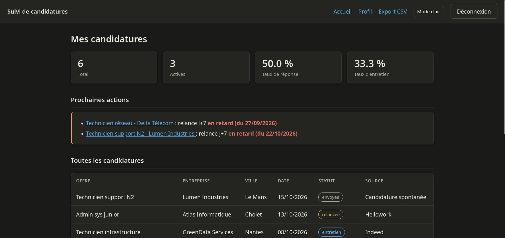
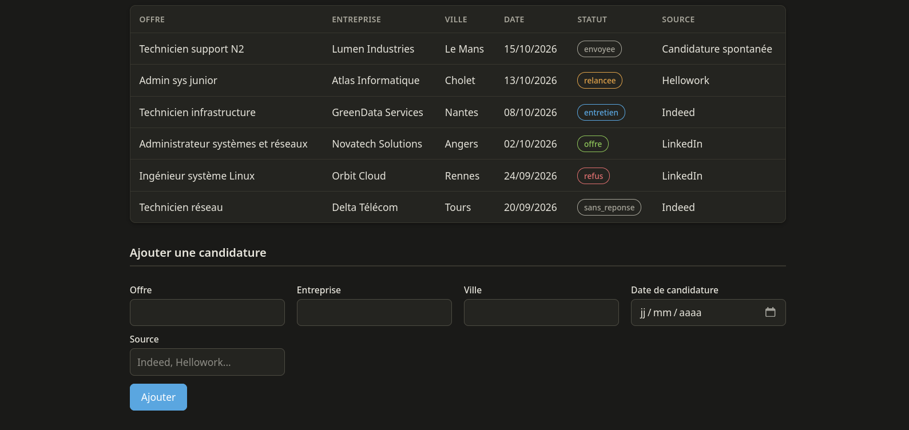
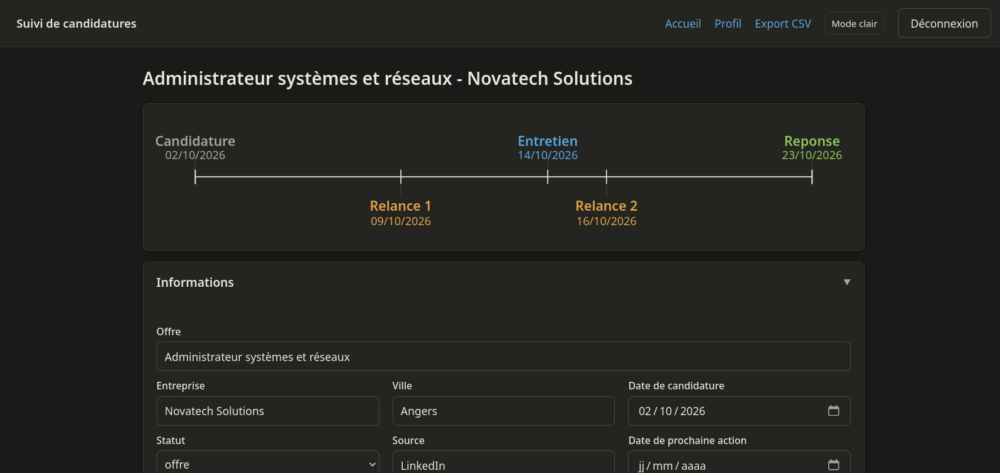
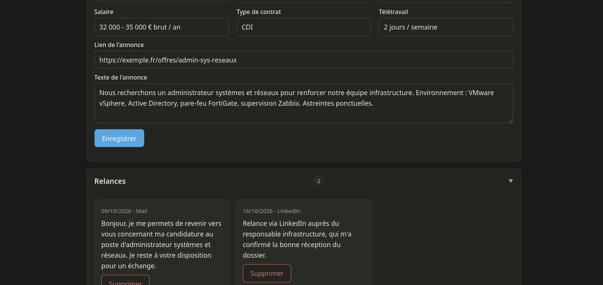
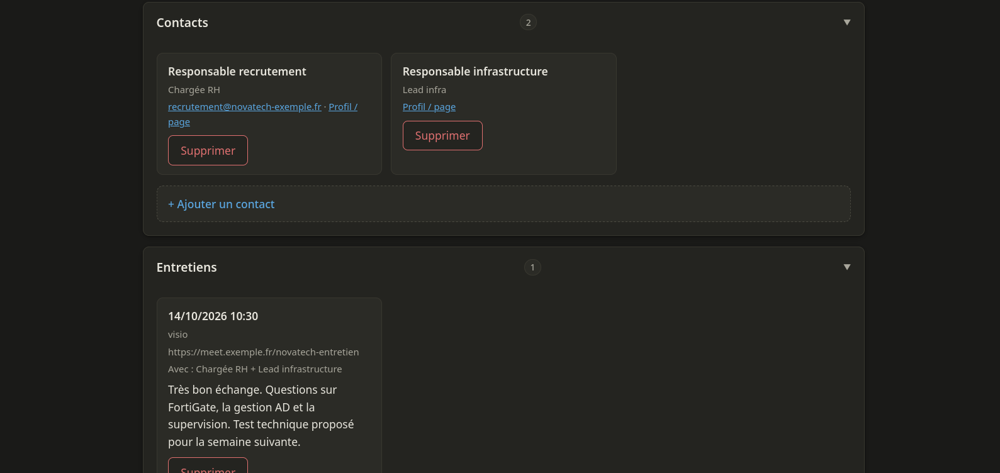
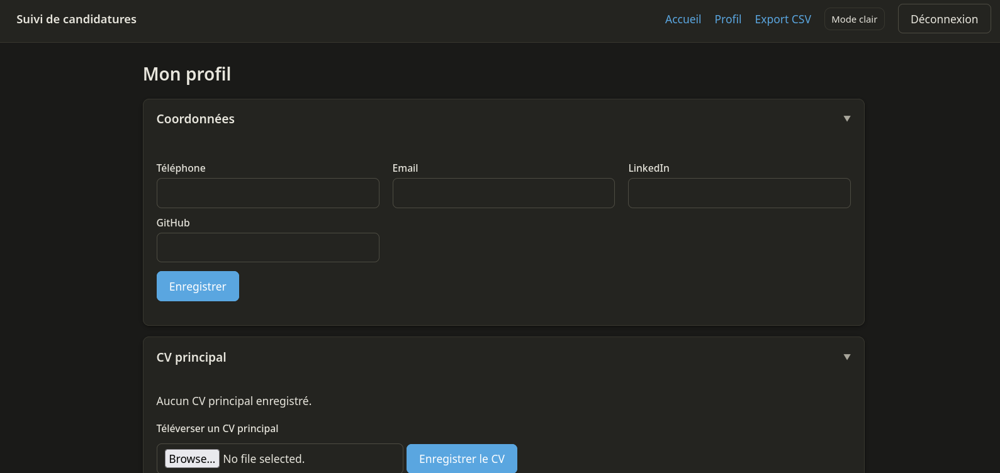

# Suivi de candidatures

Application web auto-hébergée pour suivre ses candidatures : tableau de bord,
relances, contacts, entretiens, documents (CV, lettres de motivation) et frise
chronologique par candidature. Pensée pour un usage solo ou à quelques
personnes, déployable en une commande avec Docker.

## Aperçu

Les captures ci-dessous proviennent du jeu de données de démonstration
(`donnees_demo/`) : entreprises, contacts et annonces sont fictifs.

### Page d'accueil

Compteurs de synthèse (total, actives, taux de réponse, taux d'entretien),
rappel des relances en retard, puis tableau de toutes les candidatures.



Le tableau complet, avec les statuts colorés, et le formulaire d'ajout rapide
en bas de page.



### Détail d'une candidature

Frise chronologique en haut, dérivée des dates réelles : positions
proportionnelles, étiquettes colorées selon le type d'action. Suivent les
informations du poste.



Informations de l'annonce (salaire, contrat, télétravail, texte de l'offre) et
relances, avec le texte exact du message envoyé conservé pour relecture.



Contacts rattachés à la candidature, et entretiens avec leur date, leur type,
les personnes présentes et les notes prises.



### Profil

Coordonnées réutilisables et CV principal, rattachable ensuite à n'importe
quelle candidature.



### Thème clair et sombre

L'interface suit le thème du système et propose une bascule manuelle, dont la
préférence est mémorisée dans le navigateur. Les captures ci-dessus sont prises
en thème sombre.

## Fonctionnalités

- Tableau des candidatures avec statut, source et ajout rapide
- Compteurs de synthèse et liste des relances dues (échéances J+7 / J+14 / J+21)
- Détail par candidature :
  - frise chronologique dérivée des dates (candidature, relances, entretien, réponse)
  - relances : date, moyen et corps exact du message, archivés
  - contacts : nom, poste, email, lien LinkedIn ou page web
  - entretiens : date/heure, type, lieu ou lien, personnes, notes
  - informations du poste : annonce (lien + texte), salaire, contrat, télétravail
  - documents : CV et lettres de motivation téléversés, ou réutilisation du CV principal
- Profil : coordonnées et CV principal réutilisable
- Export CSV de toutes les candidatures (justificatif d'activité, reprise tableur)
- Interface responsive (adaptée mobile / tablette / desktop) avec mode sombre
- Sections repliables et cartes sur la fiche détail
- Authentification locale (comptes internes) ou OIDC (SSO)
- Isolation complète des données entre utilisateurs

## Stack technique

- Python 3.12, FastAPI, SQLAlchemy
- SQLite (mode WAL), fichiers stockés sur disque
- Gabarits Jinja2 côté serveur, JavaScript vanilla (frise SVG)
- Authentification : argon2 (local) ou Authlib (OIDC)

Démarche de sécurité : voir [SECURITE.md](SECURITE.md).

## Démarrage rapide (Docker, auth locale)

```bash
cp .env.example .env
# Renseigner ADMIN_EMAIL et ADMIN_PASSWORD dans .env pour créer le premier compte
docker compose up -d
```

L'application est disponible sur http://localhost:8000.

Le compte administrateur défini par `ADMIN_EMAIL` / `ADMIN_PASSWORD` est créé
automatiquement au premier démarrage. Pour créer un compte ensuite :

```bash
docker compose exec app python creer_utilisateur.py <email> "<Nom affiché>"
```

## Déploiement avec SSO (OIDC)

Un second fichier Compose démarre l'application avec un fournisseur OIDC léger
(Pocket ID par défaut, interchangeable avec Authelia, Authentik, Keycloak,
Zitadel...).

```bash
# Renseigner les variables OIDC_* et SSO_PUBLIC_URL dans .env
docker compose -f docker-compose.oidc.yml up -d
```

L'application se branche sur n'importe quel fournisseur OIDC via trois
paramètres : `OIDC_ISSUER_URL`, `OIDC_CLIENT_ID`, `OIDC_CLIENT_SECRET`. La
découverte des points d'accès est automatique.

Deux points d'attention pour le mode OIDC :

- déclarer l'URL de callback de l'application, `https://votre-domaine/auth/callback`,
  comme redirect URI autorisée dans le fournisseur ;
- ce scénario suppose un reverse proxy avec nom de domaine (le SSO exige une
  cohérence d'URL entre navigateur et application). En pur `localhost:port`, le
  flux OIDC peut échouer.

## Configuration

Toute la configuration passe par le fichier `.env` (voir `.env.example`) :

| Variable | Rôle | Défaut |
|---|---|---|
| `AUTH_MODE` | `local` ou `oidc` | `local` |
| `ENABLE_DOCS` | Expose les pages de documentation générées par FastAPI, `/docs`, `/redoc` et `/openapi.json` (sans authentification) | `false` |
| `ADMIN_EMAIL` / `ADMIN_PASSWORD` | Compte créé au premier démarrage (mode local) | vide |
| `SECRET_KEY` | Clé de session ; `change-me` = génération auto persistée | `change-me` |
| `SESSION_COOKIE_SECURE` | Drapeau `Secure` du cookie de session (à activer en HTTPS) | `false` |
| `SESSION_MAX_AGE` | Durée de vie d'une session, en secondes | `43200` (12 h) |
| `DATA_DIR` | Dossier des données persistantes | `data` |
| `MAX_UPLOAD_BYTES` | Taille maximale d'un fichier téléversé | 10 Mo |
| `UPLOAD_EXTENSIONS` | Extensions autorisées au téléversement, séparées par des virgules | `pdf,doc,docx,odt,png,jpg,jpeg,webp` |
| `OIDC_ISSUER_URL` / `OIDC_CLIENT_ID` / `OIDC_CLIENT_SECRET` | Fournisseur OIDC | vide |

### Pages de documentation générées par FastAPI

L'application n'expose pas d'API : tout est rendu côté serveur, en HTML et en
formulaires. FastAPI génère malgré tout une documentation de ses routes sur
`/docs`, `/redoc` et `/openapi.json`.

`ENABLE_DOCS` est à `false` par défaut, donc ces trois URL renvoient 404. Elles
n'exigeaient aucune authentification et publiaient la liste de toutes les routes
et de tous les champs de formulaire ; elles chargent par ailleurs leurs
ressources depuis un CDN, ce que la politique de sécurité du contenu bloque.
Elles n'ont d'intérêt que pour inspecter les routes en développement.

### Cookie de session

Le cookie de session est toujours `HttpOnly` (inaccessible au JavaScript) et
`SameSite=Lax`, ce qui constitue la protection anti-CSRF de l'application.

`SESSION_COOKIE_SECURE` reste à `false` par défaut pour permettre un accès en
HTTP local. **Passez-le à `true` dès que l'application est servie en HTTPS**
derrière un reverse proxy : sans cela, le cookie de session circule en clair.
À l'inverse, activer ce drapeau sur un accès `http://` empêche toute connexion,
le navigateur ignorant alors le cookie.

`SESSION_MAX_AGE` vaut 12 heures, au lieu des 14 jours par défaut de Starlette.
La session est un cookie signé, sans état côté serveur : elle ne peut pas être
révoquée à distance, et seule la suppression de `data/secret.key` invalide
immédiatement toutes les sessions en cours. Une durée courte limite donc la
fenêtre d'usage d'un cookie volé. Allongez-la si la reconnexion quotidienne vous
gêne, par exemple `604800` pour 7 jours.

### Téléversements

Seules les extensions de `UPLOAD_EXTENSIONS` sont acceptées, et le type MIME est
déterminé par le serveur à partir de l'extension, jamais repris de ce
qu'annonce le navigateur. Les documents sont toujours servis en téléchargement
forcé. N'ajoutez pas `svg` ni `html` à cette liste : un tel fichier, consulté
ensuite, s'exécuterait dans l'origine de l'application.

### Clé de session

Laissée à `change-me`, une clé aléatoire est générée au premier démarrage et
persistée dans `data/secret.key`. Elle reste stable entre redémarrages (pas de
déconnexion à chaque `restart`) et fait partie de la sauvegarde du volume.

## Sauvegarde et restauration

Toutes les données persistantes (base SQLite, fichiers téléversés, clé de
session) vivent dans le dossier `data/`.

```bash
# Sauvegarde
cp -r data/ sauvegarde-$(date +%Y%m%d)/

# Restauration : remettre le dossier data/ en place, puis
docker compose up -d
```

## Mise à jour

```bash
git pull
docker compose up -d --build
```

Le schéma de base est créé automatiquement au démarrage. Cette version n'inclut
pas de migrations (Alembic) : tant que le modèle de données ne change pas, aucune
action n'est nécessaire.

## Dépannage

### `PermissionError` dans `data/` au démarrage

L'application tourne dans le conteneur sous un utilisateur non privilégié
(uid 1000), et non sous `root`. Le dossier `data/` doit donc lui appartenir.

Si le conteneur échoue au démarrage sur un `PermissionError` portant sur un
fichier de `data/` (dossier restauré depuis une sauvegarde, copié depuis une
autre machine, ou dont l'appartenance a été modifiée), réattribuer le volume à
l'utilisateur applicatif :

```bash
docker run --rm -v "$PWD/data":/data alpine chown -R 1000:1000 /data
```

Cette commande emprunte les privilèges de Docker et ne nécessite pas `sudo`.
L'équivalent direct est `sudo chown -R 1000:1000 data/`.

Si votre compte hôte n'est pas en uid 1000, vous pouvez à l'inverse aligner le
conteneur sur votre compte, en ajoutant au service `app` du fichier Compose :

```yaml
    user: "${UID}:${GID}"
```

## Développement local (sans Docker)

```bash
python -m venv .venv && source .venv/bin/activate
pip install -r requirements.txt
python creer_utilisateur.py vous@example.com "Votre nom"
uvicorn app.main:app --reload
```

## Jeu de démonstration

Pour découvrir l'application, régénérer les captures d'écran ou contribuer sans
saisir des candidatures à la main, le dossier `donnees_demo/` fournit un jeu de
données **entièrement fictif** :

```bash
docker compose exec app python donnees_demo/seed_demo.py
```

Cela crée le compte `demo@exemple.fr` (mot de passe `demo`) et six candidatures
à différents stades, dont une complète avec relances, contacts, entretien et
annonce, pour illustrer la fiche détail et la frise chronologique.

À lancer sur une base vierge, et jamais sur une instance réelle. Détails et
avertissements dans [donnees_demo/README.md](donnees_demo/README.md).

## Contribuer

```bash
# Instance de travail avec un jeu de donnees fictif
cp .env.example .env
docker compose up -d
docker compose exec app python donnees_demo/seed_demo.py
```

Les tests tournent dans un conteneur Python 3.12, la même version que l'image :

```bash
docker run --rm -v "$PWD":/src:ro -w /w python:3.12-slim sh -c \
  'cp -r /src/. /w/ && pip install -q -r requirements.txt pytest && pytest -q'
```

Deux règles à respecter dans les contributions :

- **aucune donnée réelle ou personnelle** dans le dépôt, captures d'écran
  comprises : utiliser `donnees_demo/` ;
- lire [SECURITE.md](SECURITE.md) avant de toucher à l'authentification, au
  téléversement de fichiers ou aux gabarits.

## Tests

```bash
pip install pytest
pytest
```

## Structure du projet

```
app/
  main.py            Point d'entrée, montage des routes
  config.py          Configuration (.env)
  database.py        Connexion SQLite (WAL)
  models.py          Tables SQLAlchemy
  schemas.py         Modèles Pydantic
  session.py         Session et utilisateur courant
  auth/              Authentification locale et OIDC
  routes/            Routes HTTP (candidatures, relances, contacts...)
  services/          Logique métier (timeline, stats, calcul des relances)
  templates/         Gabarits Jinja2
  static/            CSS et JavaScript
creer_utilisateur.py Création d'un compte en ligne de commande
donnees_demo/        Jeu de données fictif (démo, captures, contribution)
data/                Données persistantes (volume) - non versionné
tests/               Tests
```

## Licence

MIT. Voir le fichier `LICENSE`.
